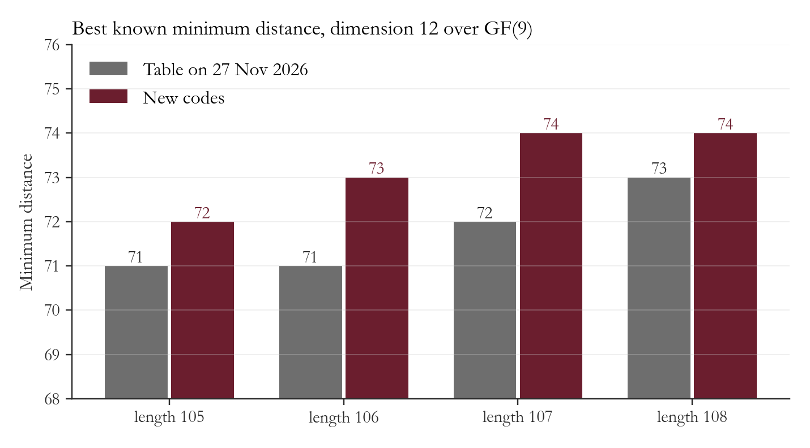
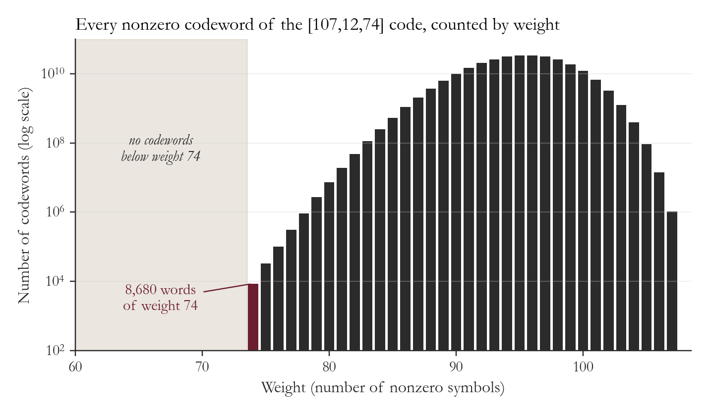

# A New Linear Code over GF(9)

*How a \[107,12,74\] code was found, checked and published*

Mike Cannon

*27 November 2026*

[Paper PDF](paper/gf9-preprint.pdf) · [Editable manuscript](paper/gf9-preprint.docx) · Preprint DOI (reserved): 10.5281/zenodo.24630883 · [Published dataset](https://doi.org/10.5281/zenodo.24611880)

The comparisons with Grassl’s tables and the publication history below refer to 27 November 2026. The four codes improve the bounds displayed on that date; their optimality and absolute priority are open.

## Contents

**1.** Executive Summary

**2.** Introduction

**3.** Core Concepts

**4.** What Was Found

**5.** How It Was Found

**6.** How It Was Checked

**7.** Credit and Earlier Work

**8.** The Publication Record

**9.** Limits and Open Risks

**10.** What Comes Next

**11.** Synthesis

**12.** Glossary

**13.** Further Reading

## Executive Summary

On 27 November 2026 a new error-correcting code was found, verified and published. In the notation of the field it is a linear \[107,12,74\] code over GF(9). The standard public record of such codes, maintained by Markus Grassl at codetables.de, showed 72 as the best known value for a code of that size. The new code reaches 74. Three related codes, at lengths 105, 106 and 108, follow from the same construction and also improve the record at their sizes.

The result is small and it is real. It was not produced by a new mathematical idea. It came from applying a recipe published two weeks earlier by S. Cochinescu to a record code published in 2019 by N. Aydin, G. Bakbouk and J. G. G. Lambrinos, and then proving by exhaustive computation that the outcome has the claimed strength. The new contribution is the specific choice that makes the recipe work on that code, together with the verification.

The work was directed by one person without mathematical training and carried out by AI coding agents. The claim was checked by four separately written programs, by the Magma computer algebra system, and by two rounds of hostile review from AI systems built by two different developers. The one source that could have contained the result already, a paywalled journal paper, was obtained and read directly. It does not contain it.

The result is archived on Zenodo under doi:10.5281/zenodo.24611880 and in a public repository at github.com/Mike-Cannon/gf9-107-12-74. At the time of writing, the submission to the maintainer of the tables had been drafted and not yet sent.

**What this paper covers.** It explains what an error-correcting code is and why a table of records exists, states exactly what was found, tells how it was found and checked, separates what is new from what is owed to others, records what was published and where, and sets out the limits of the result and the plan for further work.

## Introduction

Every digital message is at risk of damage. A scratch on a disc, noise on a radio link or a failing memory cell can change some of the symbols that were sent. An error-correcting code is a rule for adding carefully chosen redundancy to a message so that the receiver can detect such damage and repair it. The mathematics dates from the late 1940s and is in daily use in storage, broadcasting and space communication.

A code is judged by three numbers. The first is how long each transmitted block is. The second is how much real information each block carries. The third is how different any two valid blocks are guaranteed to be, which determines how many errors can be repaired. Longer blocks cost more to send; more information per block is more efficient; greater difference is more robust. The three pull against each other, and the central question of the subject is how good the third number can be once the first two are fixed.

For most sizes nobody knows the answer. What is known is a lower figure, achieved by the best code anyone has built, and a higher figure, which theory proves cannot be beaten. The truth lies somewhere between. Since the 1990s these two figures have been kept in public tables, now maintained by Markus Grassl. An entry in the table is a small permanent fact about mathematics. Raising a lower figure by even one means exhibiting a code better than any previously known at that size.

Such improvements are usually modest and usually computational. They are found by searching large families of structured codes, or by taking a good code and modifying it with a standard construction. They are announced by sending the code to the maintainer of the tables, sometimes with a short paper. The work described here is of exactly that kind.

**Key Takeaways**

- An error-correcting code adds redundancy so that damaged messages can be repaired.

- For most sizes the best possible code is unknown; public tables record the best one found so far.

- Improving a table entry is a small, permanent and checkable contribution.

- Most improvements come from computer search or from modifying a known code.

## Core Concepts

### **The three parameters**

A linear code is described as \[n, k, d\]. The **length** n is the number of symbols in each codeword. The **dimension** k measures how much information a codeword carries: a code of dimension 12 over an alphabet of nine symbols has 9 to the power 12 codewords, about 282 billion. The **minimum distance** d is the smallest number of positions in which two different codewords differ. A code with minimum distance d can correct any pattern of fewer than d/2 errors.

For a linear code the minimum distance equals the smallest **weight** of any nonzero codeword, where weight means the number of nonzero symbols. This turns the problem of proving a minimum distance into a counting exercise: examine every nonzero codeword and record the lightest. The exercise is finite and mechanical, which is why a claim of this kind can be verified by anyone with a computer.

### **The alphabet GF(9)**

The symbols of a code are drawn from a finite field, a number system with finitely many elements in which addition, subtraction, multiplication and division all work. There is one such field for each power of a prime. GF(9) has nine elements. They can be written as a + b·w, where a and b are each 0, 1 or 2 and w is a special element satisfying w² = w + 1. The tables cover fields of up to nine elements, and GF(9) is the largest and least explored of them.

### **Quasi-cyclic codes**

Searching all codes of a given size is hopeless; there are far too many. Searches therefore concentrate on codes with symmetry. A **quasi-cyclic code** is built from blocks of equal size, and rotating every block by one position turns any codeword into another codeword. This symmetry means the whole code is described by a few short polynomials, and it makes both searching and checking far cheaper. Many record codes are quasi-cyclic.

### **Construction X**

**Construction X**, introduced in 1972, builds a longer code from two existing ones, a smaller code sitting inside a larger one. The larger code carries more information and has a smaller minimum distance. The construction appends extra symbols to exactly those codewords that lie outside the smaller code, which are the ones responsible for the reduced distance, and so raises their weight. In its simplest form one extra dimension is added to a code and a repeated symbol is appended, giving a code of length n + s and dimension k + 1.

**Key Takeaways**

- \[n, k, d\] means length n, dimension k, minimum distance d; larger d is better.

- The minimum distance is the weight of the lightest nonzero codeword, so it can be found by counting.

- GF(9) is a number system with nine elements, used as the alphabet.

- Quasi-cyclic codes have a block symmetry that makes search and checking practical.

- Construction X extends a code by one dimension and repairs the weak codewords with extra symbols.

## What Was Found

The main result is a linear code over GF(9) of length 107 and dimension 12 with minimum distance 74. On the day it was found, the table listed 72 for that length and dimension. The entry it improves was last changed in October 2003.

Three further codes follow from the same construction. Removing the last coordinate of the main code, or the last two, gives codes of length 106 and 105. Continuing the construction with one more appended symbol gives a code of length 108. Each improves the table at its own size. These are consequences of one result and should not be counted as four discoveries.

*Table 1. The four codes against the table on 27 November 2026.*

| **Code** | **Table lower bound** | **Table upper bound** | **Lightest codewords** |
|----|----|----|----|
| \[105,12,72\] | 71 | 83 | 3,080 |
| \[106,12,73\] | 71 | 84 | 3,080 |
| \[107,12,74\] | 72 | 85 | 8,680 |
| \[108,12,74\] | 73 | 86 | 5,600 |



*Figure 1. The improvement at each of the four lengths.*

The upper bounds show how much room remains. At length 107 theory allows a minimum distance as high as 85, so the new code is not claimed to be the best possible. It is the best that has been exhibited.

### **The construction in plain terms**

The starting point is a quasi-cyclic code of length 105 and dimension 11 with minimum distance 74, built from three blocks of 35 symbols. It is item 55 in Section 5.1 of the 2019 paper of Aydin, Bakbouk and Lambrinos and was already the record at its size.

One new codeword is added to it: a vector that is constant on each block, with the value 1 on the first two blocks and the value w to the sixth power on the third. Adding it raises the dimension from 11 to 12. The new codewords this creates are lighter than the old ones; the lightest has weight 72. Two extra symbols are then appended to every codeword, zero for the old codewords and a repeated nonzero symbol for the new ones. That lifts the weight of the new codewords from at least 72 to at least 74, level with the old ones. The result has length 107, dimension 12 and minimum distance 74.

There are 91 essentially different vectors of this block-constant kind. In the scan that produced the result, exactly one of them gave a lightest new codeword of weight 72. The others gave less, and with less than 72 the construction does not beat the table.



*Figure 2. The complete weight count for the main code. The proof of the result is that the left-hand region is empty.*

**Key Takeaways**

- The main result is \[107,12,74\] over GF(9), against a table value of 72.

- Codes at lengths 105, 106 and 108 follow from it and also beat the table.

- The base code belongs to Aydin, Bakbouk and Lambrinos; one added vector and two appended symbols give the new code.

- Only one of 91 candidate vectors works.

- The code is not known to be optimal; theory allows up to 85.

## How It Was Found

The project began with a question about what a person without mathematical training could contribute to mathematics by directing AI systems. Tables of best known codes were chosen because improvements there are concrete, checkable by machine and accepted as genuine, and because the largest alphabet in the tables, GF(9), is the least worked over.

### **A search program**

The first step was a program, written in Rust, that searches families of quasi-cyclic and related codes over GF(9) and computes minimum distances exactly. Its core packs many codewords into single machine words so that the arithmetic of GF(9) is carried out on dozens of positions at once. It was later extended to run on graphics processors, where the same check runs many times faster, and then to use several cards together.

The search ran on a rented processor server and then on a rented machine with two graphics cards. Across 31 families of codes at dimension 10 it found 827 codes that equal the existing record and none that beat it. Matching the record repeatedly showed that the program was sound. It also showed that this region had been thoroughly searched by others, in particular by E. Z. Chen, whose database of such codes records two decades of work.

### **Building on earlier work**

The decisive change of direction was a survey of what others had already done. It turned up two things. One was Chen's database, which lists record quasi-cyclic codes explicitly. The other was a preprint posted on 10 November 2026 by S. Cochinescu, describing a simple way to turn a good quasi-cyclic code into a new code of one higher dimension by adding a block-constant vector and appending repeated symbols. Cochinescu applied it to codes of dimension up to 8 and reported several new records.

The recipe had not been applied at higher dimensions, and there is a practical reason. Each candidate must be checked by examining every codeword. At dimension 8 that is a few million; at dimension 12 it is 35 billion. The first is easy in any programming language. The second needs purpose-built software, which by then existed.

The recipe was therefore run against every suitable GF(9) code in Chen's database, trying every block-constant vector for each. One base code, with one vector, produced a record. The same sweep applied to the 827 codes from the project's own search produced nothing.

**Key Takeaways**

- A fast exact checker for large codes over GF(9) was built first, including a version for graphics cards.

- The project's own search matched existing records 827 times and beat none.

- The result came after surveying earlier work and applying a two-week-old recipe to a database of known record codes.

- The advantage was the ability to check 12-dimensional codes cheaply, which the recipe's author did not have.

## How It Was Checked

A claim about a minimum distance is a claim about a finite list. The main code has 9 to the power 12 codewords. Because multiplying a codeword by a nonzero constant does not change its weight, it is enough to examine one from each family of eight, which leaves 35,303,692,060 to check. The checks were layered so that no single program or person had to be trusted.

### **Four programs**

The search program reported the result on both processor and graphics card. A second program was then written from nothing, with different arithmetic, by an AI system instructed to try to refute the claim; it counts every weight and is the one included in the published package. A third, also written to refute, enumerated the base code and derived the new weights by a different route. A fourth was written by an AI system from a different developer, given only the generator matrices. All four agree on the four minimum distances and on the number of lightest codewords.

### **Magma**

Magma is the computer algebra system on which the tables themselves rely. A licence was not available, and its free online calculator stops any computation after 60 seconds, which is not enough for a code of this size. The code was therefore divided into 820 overlapping pieces of dimension 9, chosen so that every codeword lies in at least one piece. Magma computed the minimum distance of each piece separately. All 820 returned 74. This covers the main code; the codes of length 105 and 106 inherit their bounds from it, and the code of length 108 rests on the four programs alone.

### **Two rounds of hostile review**

Before publication, two reviewers were asked to break the claim: one AI system from each of two developers, working separately. The first round recomputed the distances, read the table values live, and searched for earlier work. It found a code published three weeks earlier by R. Pinho with parameters \[106,12,72\], which the present \[106,12,73\] improves by one, and it corrected the attribution of the base code.

The second round reviewed the publication package itself. It found no error in the mathematics and no earlier publication of the result. It did find statements that claimed more than a reader could verify from the package, and those were rewritten. It also identified two earlier papers whose methods this construction is an instance of, which were added to the credits.

### **The paywalled paper**

One risk remained. The paper in which the base code first appeared sits behind a paywall, and nobody involved had read it. If it already contained the new code, the result would not be new. The paper was obtained and read. The base code is its item 55, and the three polynomials printed there satisfy the expected relations with the ones used here. The paper's codes of dimension 12 over GF(9) have lengths 112, 120, 123 and 130, and none can be reduced to match the new result. The construction used here does not appear in it.

**Key Takeaways**

- The proof is an exhaustive count of 35 billion codewords.

- Four separately written programs and the Magma system agree.

- Two rounds of adversarial review found no mathematical error and tightened the wording.

- The source paper for the base code was read directly and does not contain the result.

## Credit and Earlier Work

The result stands on the work of others, and an honest account of it has to say which parts.

*Table 2. What is new and what is owed to others.*

| **Ingredient** | **Source** |
|----|----|
| The base \[105,11,74\] code | Aydin, Bakbouk and Lambrinos, 2019, item 55 |
| The general technique, Construction X | Sloane, Reddy and Chen, 1972 |
| Applying it to chains of quasi-cyclic codes | Grassl and White, 2005 |
| Adding block-constant vectors to quasi-cyclic codes | Aydin, Connolly and Murphree, 2017 |
| The specific recipe and its distance formula | Cochinescu, 2026, Lemma 3 |
| The database that was swept | E. Z. Chen |
| The choice of vector for this base code, the proof that it gives 72, and the resulting codes | This work |

The contribution is therefore one observation: that a particular vector, added to a particular known code, gives a coset of minimum weight 72. Everything else is assembly and verification. That is typical of entries in the table, most of which are an existing code combined with a standard construction. It is also the reason the result is described as a table improvement and not as a research advance.

The comparison with the record deserves equal care. The claim is that the code beats the figures displayed in the table on 27 November 2026. It is not a claim that nobody has ever found such a code. The table does not yet show some codes reported by others in the preceding weeks, and several groups are scanning the same tables with similar tools.

**Key Takeaways**

- The base code, the construction and the recipe all belong to others and are credited by name.

- The new element is one choice of vector and the proof of its effect.

- The claim is a dated comparison with the public table, not a claim of absolute priority.

## The Publication Record

The result was made public in a way that fixes its date independently of anyone's decision to accept it.

*Table 3. Where the result is recorded.*

| **Record** | **Detail** |
|----|----|
| Zenodo deposit | doi:10.5281/zenodo.24611880, published 27 November 2026, 23:08 UTC |
| Public repository | github.com/Mike-Cannon/gf9-107-12-74 |
| Author as published | Mike Cannon, independent researcher |
| Licence | CC BY 4.0 for data and text; MIT for programs |
| Submission to the tables | Email to codes@codetables.de drafted; not yet sent at the time of writing |

The deposit contains the four generator matrices, a short script that rebuilds them from the base code, the enumeration program with its output, and the Magma material. The repository holds the same files; the two were compared file by file after publication and are identical. The published text says that AI systems were used and does not name them.

Acceptance into the tables is a separate matter and is at the maintainer's discretion. Codes sent by others three weeks earlier had not yet appeared. A reply may take weeks, and the dated deposit does not depend on it.

**Key Takeaways**

- The result has a permanent DOI and a public repository, both dated 27 November 2026.

- The deposit lets any reader rebuild and recheck the codes.

- Entry into the tables depends on the maintainer and had not yet been requested.

## Limits and Open Risks

The result is modest. It raises four entries by one or two, at sizes where the gap to the theoretical ceiling is still eleven or twelve. It uses no new method. A specialist would regard it as a legitimate minor improvement, properly attributed and unusually thoroughly checked.

It may not be first. The table lags behind submissions, and a code with the same parameters could already be waiting in the maintainer's inbox or sitting in a source that the searches did not reach. The 2019 paper mentions 82 further codes derived by routine operations that were sent to the tables without being listed; those cannot be inspected individually, though the table's current figures make it unlikely that any of them matches.

Some supporting statements rest on the author's report and cannot be confirmed from the deposit: the agreement of three of the four programs, and the count of one success among 91 vectors. The published text marks these as such. The full Magma files have never been run to completion; the piecewise check is a substitute that is mathematically sound and less direct.

Finally, the original ambition was a code found from nothing by the project's own search. That has not been achieved. What was achieved depended on a recipe that had been public for two weeks, and others with similar tools could reach the same result.

**Key Takeaways**

- The improvement is real and small.

- Priority cannot be guaranteed while the table lags and others search the same ground.

- A few supporting claims are reported, not demonstrated, and are labelled accordingly.

- A code found entirely by the project's own search remains an open goal.

## What Comes Next

The lasting asset is the fast checker. It makes dimensions 12 and above affordable, and the age of the entries just improved suggests that few people work there. Several directions follow, in rough order of promise.

The same recipe can be pushed one dimension higher, from 12 to 13, where each check costs nine times as much. It can be applied to codes longer than 130, which were excluded from the first sweep for speed. It can be applied twice, adding two vectors, since the intermediate code is still quasi-cyclic. The checker can be ported to GF(7) and GF(8), where the recipe's author stopped at dimension 8. The project's own search can be pointed at dimensions 11 and 12. And Chen's more sophisticated search method could be implemented and paired with the checker.

None of these is certain to yield anything. A rough expectation, on thin evidence, is between zero and five further base codes, each worth up to four table entries. A separate planning document in the project folder sets out each idea with its cost and its stopping condition.

**Key Takeaways**

- The reusable advantage is cheap exact checking of large codes.

- The nearest opportunities are the same recipe at dimension 13, on longer codes, and over GF(7) and GF(8).

- A fully original code from the project's own search remains the larger prize.

## Synthesis

The episode shows a route by which a non-specialist can add a verified fact to mathematics. The ingredients were a well-chosen problem, where correctness can be established by computation alone; a piece of engineering that removed a practical barrier others faced; a willingness to build on published work and to say so; and a degree of checking well beyond what the size of the result would normally attract.

It also shows the limits of that route. The contribution is an observation and its proof, located by sweeping a recent idea across an existing database. The same route is open to anyone with similar tools, and several people are on it. What distinguishes a result of this kind is less the finding than the care taken to establish that it is true, that it is correctly attributed, and that it is stated at its real size.

The reader of this paper should now be able to say what a \[107,12,74\] code is, why it counts as an improvement, what in it is new, how one knows it is correct, and what would have to happen for the result to be superseded or to turn out not to be first.

## Glossary

- **Base code.** The existing code that a construction starts from. Here, the \[105,11,74\] code of Aydin, Bakbouk and Lambrinos.

- **Block-constant vector.** A vector that takes a single value on each block of a quasi-cyclic code.

- **Codeword.** One of the valid blocks of a code. A code of dimension k over GF(9) has 9 to the power k codewords.

- **Construction X.** A 1972 method that combines a code, a smaller code inside it and a short auxiliary code into a longer code with better distance.

- **Coset.** The set obtained by adding one fixed vector to every codeword of a code. The new codewords created by adding a vector form cosets of the base code.

- **Dimension (k).** The number of independent symbols of information in each codeword.

- **Generator matrix.** A table of k rows whose combinations produce every codeword. It is the usual way to write a code down.

- **GF(9).** The finite field with nine elements, used here as the alphabet.

- **Length (n).** The number of symbols in each codeword.

- **Lower bound.** In the tables, the minimum distance of the best code actually known at a given size.

- **Magma.** A computer algebra system widely used in coding theory, and the reference tool for the tables.

- **Minimum distance (d).** The smallest number of positions in which two different codewords differ; for a linear code, the smallest weight of a nonzero codeword.

- **Puncturing.** Deleting a coordinate from every codeword. It shortens the code by one and lowers the minimum distance by at most one.

- **Quasi-cyclic code.** A code made of equal blocks that is unchanged when every block is rotated by one position.

- **Upper bound.** In the tables, a value that theory proves no code of the given size can exceed.

- **Weight.** The number of nonzero symbols in a codeword.

## Further Reading

- **M. Grassl, Bounds on the minimum distance of linear codes and quantum codes, codetables.de.** The tables themselves. Each entry shows the bounds and how the best known code is built.

- **N. Aydin, G. Bakbouk and J. G. G. Lambrinos, New linear codes over non-prime fields, Cryptography and Communications 11 (2019), 891–902.** The source of the base code, and a clear example of how record codes are found by search.

- **S. Cochinescu, New linear codes over GF(7), GF(8) and GF(9) from quasi-cyclic codes and Construction X, arXiv:2611.14433 (2026).** The recipe used here. Short and readable.

- **N. J. A. Sloane, S. M. Reddy and C.-L. Chen, New binary codes, IEEE Transactions on Information Theory 18 (1972), 503–510.** The original Construction X.

- **M. Grassl and G. White, New codes from chains of quasi-cyclic codes, Proceedings of ISIT 2005, 2095–2099.** Construction X applied to nested quasi-cyclic codes, the setting of this result.

- **N. Aydin, N. Connolly and J. Murphree, New binary linear codes from quasi-cyclic codes and an augmentation algorithm, AAECC 28 (2017), 339–350.** An earlier use of block-constant augmentation.

- **E. Z. Chen, Online database of quasi-twisted codes, databases.cs.hkr.se/qtcodes.** The database that was swept, with explicit generators for many record codes.

- **E. Z. Chen, A new iterative computer search algorithm for good quasi-twisted codes, Designs, Codes and Cryptography 76 (2015), 307–323.** The search method behind many existing records; a candidate for future work.

- **F. J. MacWilliams and N. J. A. Sloane, The Theory of Error-Correcting Codes (North-Holland, 1977).** The standard reference for the subject, for readers who want the mathematics in full.

- **M. Cannon, A linear \[107,12,74\] code over GF(9), Zenodo (2026), doi:10.5281/zenodo.24611880.** The published deposit: matrices, programs and verification record.

---

## Reproduce the four codes

I chose a problem where a proposed improvement could be tested against a dated table and checked by counting codewords. I used AI assistance to develop the search and verification programs and to review the result.

The [construction program](construct.py) rebuilds the four matrices from code 55 of Aydin, Bakbouk and Lambrinos and the block-constant vector described in the paper. The [discovery log excerpt](discovery/length-105-run-excerpt.txt) records the scan of 91 candidates for that base code and the four output parameters. It reports six candidates meeting the search threshold of 71 and a best value of 72.

| Code | Matrix | Minimum-weight words |
|---|---|---:|
| [105,12,72] | [Generator matrix](codes/gf9_105_12_72.txt) | 3,080 |
| [106,12,73] | [Generator matrix](codes/gf9_106_12_73.txt) | 3,080 |
| [107,12,74] | [Generator matrix](codes/gf9_107_12_74.txt) | 8,680 |
| [108,12,74] | [Generator matrix](codes/gf9_108_12_74.txt) | 5,600 |

From the repository or extracted ZIP root, run the following with Python 3, Rust and Cargo. The final command checks the main code. Substitute each of the other three matrix filenames to check its distance and full weight distribution.

```sh
python construct.py
cargo build --release --locked --manifest-path verify/Cargo.toml
cargo run --release --locked --manifest-path verify/Cargo.toml -- codes/gf9_107_12_74.txt 0 16
```

The [Rust verifier](verify/src/main.rs) counts 35,303,692,060 nonzero words up to scalar multiplication per code. Compare its result with the [archived weight distributions](verification_output.txt). For the main code the [Magma check](magma/README.txt) covers all 820 subcodes in three [saved batches](magma/). The [original dataset notes](DATASET.md) give field conventions, historical bounds, verification details and references.

The manuscript, matrices, figures and recorded results are licensed under CC BY 4.0. The programs are licensed under MIT. [License](LICENSE.txt)
